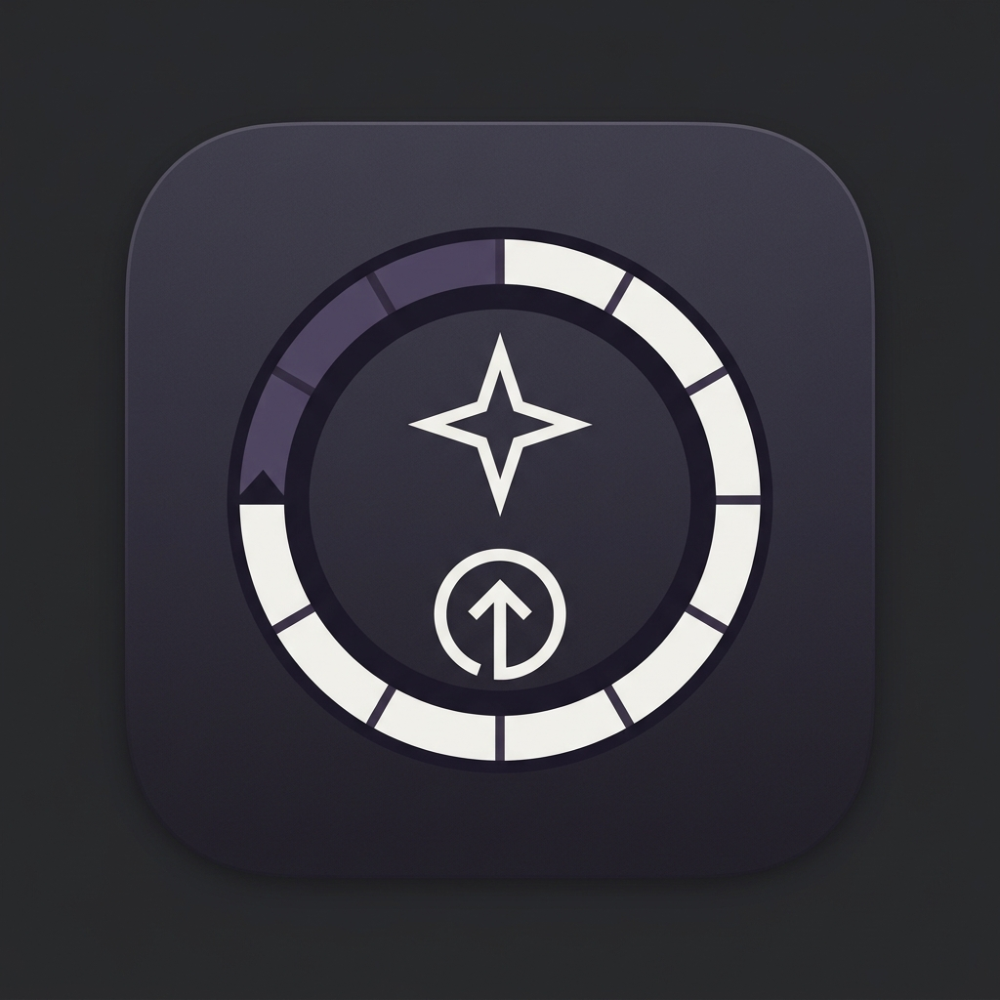
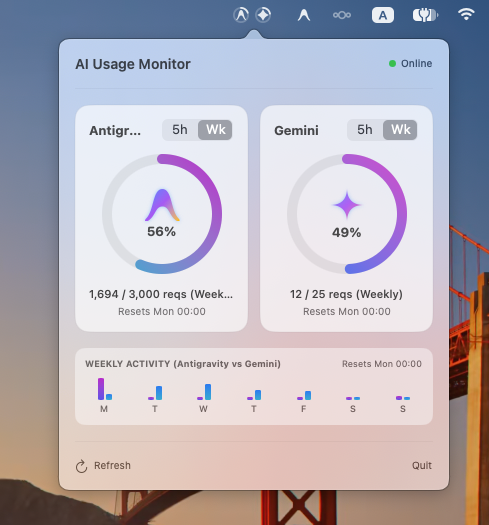

# 🪐 Gemini & Antigravity Usage Menu Bar

<p align="center">
  
  <br />
  
  
  
  
</p>

A lightweight, native macOS menu bar status item and popover widget to track your **5-hour rolling request window** and **weekly quotas** for **Google Antigravity IDE** and **Gemini**.

Built completely with **SwiftUI**, **AppKit**, and native vector drawing—rendering twin monochrome circular gauges that blend seamlessly into your macOS menu bar.

---

## ✨ Features

- **Circular Menu Bar Gauges**: 
  - Dual circular progress rings drawn directly in the status bar with centered vector SVG logos (Antigravity emblem & Google Gemini 4-point sparkle star).
  - Native macOS template icon: renders in clean monochrome white matching Wi-Fi, Battery, and Control Center icons.
- **Accurate 5-Hour Rolling Tracker**:
  - Automatically reads and parses local agent interactions from `~/.gemini/*/brain/*/.system_generated/logs/transcript.jsonl`.
  - Computes the remaining time until the oldest request slot expires in the rolling window (`Reset in: 12m 45s`).
- **Weekly Allocation & 7-Day Chart**:
  - Aggregates activity across each day of the week (Mon–Sun).
  - Displays comparative daily bar charts inside the popover.
- **Interactive Metric Toggle**:
  - Switch any gauge card between **5-Hour** and **Weekly** views with a single click.
- **Zero Dock Clutter**: Runs purely as an `LSUIElement` / accessory application in your menu bar.
- **Zero Third-Party Dependencies**: Pure native Swift standard library and macOS frameworks (`AppKit`, `SwiftUI`, `Combine`).

---

## 📸 Overview

<p align="center">
  
</p>

```
Menu Bar:
  [ (🪐) (✦) ]   <-- Twin circular progress rings with centered vector logos

Popover HUD:
┌────────────────────────────────────────────────────────┐
│  AI Usage Monitor                            ● Online  │
├──────────────────────────┬─────────────────────────────┤
│  Antigravity     [5h|Wk] │  Gemini             [5h|Wk] │
│      ( 🪐 68% )          │        ( ✦ 22% )            │
│  855 / 1,000 reqs (5h)   │  220 / 1,000 reqs (5h)      │
│  ⏱ Reset: 12m 45s        │  ⏱ Reset: 1h 45m            │
├──────────────────────────┴─────────────────────────────┤
│  WEEKLY ACTIVITY (Antigravity vs Gemini)               │
│    ▂  ▅  █  ▆  ▃  ░  ░   (Resets Mon 00:00)            │
│   M  T  W  T  F  S  S                                  │
├────────────────────────────────────────────────────────┤
│  🔄 Refresh                                     ✕ Quit │
└────────────────────────────────────────────────────────┘
```

---

## 🚀 Quick Start

### Prerequisites
- macOS Sonoma (14.0) or later
- Swift 5.9+ / Xcode Command Line Tools (`xcode-select --install`)

### Installation & Run

#### Option A: Download Pre-built App (Recommended)
1. Download the latest release: [**GeminiUsageBar-v1.0.0-macos-arm64.zip**](https://github.com/muradjabir/gemini_usage_menubar/releases/latest/download/GeminiUsageBar-v1.0.0-macos-arm64.zip)
2. Unzip and drag `GeminiUsageBar.app` to your `/Applications` folder.
3. Because this is an open-source tool without an Apple Developer paid certificate ($99/yr), macOS Gatekeeper flags downloaded zip files. If macOS shows *"damaged and can’t be opened"*, simply remove the quarantine attribute:
   ```bash
   xattr -cr /Applications/GeminiUsageBar.app
   ```
4. Launch the app and the gauges will appear in your menu bar!

#### Option B: Build from Source
1. **Clone the repository:**
   ```bash
   git clone https://github.com/muradjabir/gemini_usage_menubar.git
   cd gemini_usage_menubar
   ```

2. **Build the binary:**
   ```bash
   swift build -c release
   ```

3. **Run in background:**
   ```bash
   ./.build/release/GeminiUsageBar &
   ```

---

## 🛠️ Launch at Login (Optional)

To start the menu bar app automatically whenever you boot or log into macOS:

1. Create the LaunchAgent:
   ```bash
   mkdir -p ~/Library/LaunchAgents
   cat << 'EOF' > ~/Library/LaunchAgents/com.muradjabir.geminiusagebar.plist
   <?xml version="1.0" encoding="UTF-8"?>
   <!DOCTYPE plist PUBLIC "-//Apple//DTD PLIST 1.0//EN" "http://www.apple.com/DTDs/PropertyList-1.0.dtd">
   <plist version="1.0">
   <dict>
       <key>Label</key>
       <string>com.muradjabir.geminiusagebar</string>
       <key>ProgramArguments</key>
       <array>
           <string>/Applications/GeminiUsageBar.app/Contents/MacOS/GeminiUsageBar</string>
       </array>
       <key>RunAtLoad</key>
       <true/>
       <key>KeepAlive</key>
       <true/>
       <key>ProcessType</key>
       <string>Interactive</string>
   </dict>
   </plist>
   EOF
   ```

2. Load the LaunchAgent:
   ```bash
   launchctl load ~/Library/LaunchAgents/com.muradjabir.geminiusagebar.plist
   ```

---

## 📁 Architecture & File Layout

```
gemini_usage_menubar/
├── Package.swift                    # Swift package specification (macOS 14+, Swift 5.9+)
├── Sources/
│   └── GeminiUsageBar/
│       ├── GeminiUsageBar.swift     # Application entrypoint & NSApplicationDelegate
│       ├── StatusBarController.swift# NSStatusItem, NSPopover & template image management
│       ├── MenuBarGaugeRenderer.swift # Vector graphics engine for status bar rings & logos
│       ├── PopoverContentView.swift # Main floating HUD interface in SwiftUI
│       ├── CircularGaugeCardView.swift# Gauge card component with metric segmented toggle
│       ├── BrandLogos.swift         # Vector bezier definitions for Antigravity & Gemini
│       ├── UsageStore.swift         # Reactive store with 30s auto-polling & ticking timer
│       ├── RealUsageProvider.swift  # Local JSONL transcript parser & rolling window engine
│       └── Models.swift             # Snapshot & daily usage data structures
└── README.md
```

---

## 🤝 Contributing

Contributions, feedback, and pull requests are welcome!
1. Fork the Project
2. Create your Feature Branch (`git checkout -b feature/amazing-feature`)
3. Commit your Changes (`git commit -m 'Add amazing feature'`)
4. Push to the Branch (`git push origin feature/amazing-feature`)
5. Open a Pull Request

---

## 📄 License

Distributed under the MIT License. See `LICENSE` for more information.
